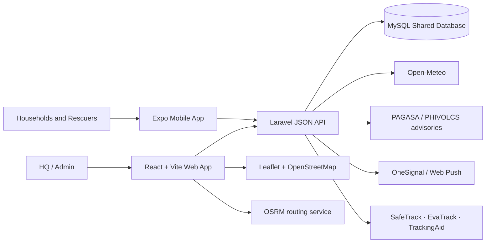

<p align="center">
  
</p>

<h1 align="center">RESQPERATION</h1>

<p align="center">
  Barangay Rescue Operations and Disaster Response Management System<br>
  A capstone project focused on disaster coordination in Mambaling, Cebu City.
</p>

<p align="center">
  <a href="../docs/DOCUMENTATION_INDEX.md">Documentation</a> ·
  <a href="docs/USE_CASES.md">Use cases</a> ·
  <a href="docs/MUST_HAVES_IMPLEMENTATION_AUDIT.md">Implementation audit</a> ·
  <a href="https://github.com/pyunpyunn/G10-CAPSTONE/releases">Releases</a>
</p>

---

## About the Project

RESQPERATION is a disaster-response coordination system with a web dashboard for barangay HQ/Admin operations and a mobile app for household residents and rescuers. It brings disaster alerts, household status reports, rescue dispatch, resource requests, weather context, and situation records into one workflow.

### Problem

During emergencies, household safety information, responder assignments, resource requests, and incident updates can be scattered across separate channels. This makes it harder for local coordinators to maintain a shared operational picture and act on current information.

### Objectives

- Give HQ/Admin a shared view of disaster events, household reports, resources, and dispatch activity.
- Let residents submit household status and location information through mobile.
- Help rescuers receive assignments and report field updates.
- Support reviewable resource-request handoffs, situation reports, and operational records.
- Present weather and hazard information with clear source attribution and limitations.

### Intended Users

| User | Primary use |
| --- | --- |
| Barangay HQ / Admin | Monitor events, review household reports, broadcast updates, coordinate dispatch, validate requests, and prepare reports. |
| Household residents | Complete household setup, report safety status, and access household/evacuation features. |
| Rescuers | Receive assignments, update field status and location, and request support. |
| Super Admin | Use system-wide administration features where enabled. |

## Mambaling at a Glance

The target barangay is **Mambaling, Cebu City**. These are dated reference figures, not live system counts.

| Reference | Figure |
| --- | ---: |
| Population (2020 Census) | **30,459** |
| Share of Cebu City's population (2020) | **3.16%** |
| Households (2015 Census) | **7,583** |
| Household population / average household size (2015) | **31,469 / 4.15** |
| Approximate map reference | **10.2922° N, 123.8763° E** |
| Elevation at that reference point | **8.3 m** above mean sea level |

Population and household statistics are from the Philippine Statistics Authority censuses, as reported by [PhilAtlas' Mambaling profile](https://www.philatlas.com/visayas/r07/cebu-city/mambaling.html). Coordinates and elevation are approximate reference-point values; they do not describe the barangay's full boundary or elevation range.

## Scope and Limitations

**In scope:** HQ/Admin web operations; household and rescuer mobile workflows; role-based access; disaster and household status monitoring; dispatch; resource-request review and partner handoff; mapping; weather/advisory context; notifications; situation reporting and archives.

**Limitations:** The initial operational focus is Mambaling. Availability depends on device connectivity, configured services, and current data. Weather forecasts and hazard maps are decision-support information, not guarantees, official local declarations, or a substitute for PAGASA, PHIVOLCS, barangay authorities, and emergency services. External partner connections require reachable partner systems and credentials; local endpoint verification does not prove a live partner connection. Public map/routing services have their own availability and usage limits. This capstone is not a replacement for official dispatch or emergency communications.

## Sustainable Development Goals

- **SDG 11 — Sustainable Cities and Communities:** supports local disaster preparedness, community safety information, and more coordinated response.
- **SDG 13 — Climate Action:** supports preparedness and risk communication by making weather and hazard context available to operators.
- **SDG 3 — Good Health and Well-being:** contributes indirectly by helping coordinate rescue and household assistance.

These are project alignments, not UN certification or a claim that software alone achieves the goals.

## System Architecture



### Main Components

| Layer | Technology |
| --- | --- |
| Backend API | Laravel 13, PHP 8.3+, Laravel Sanctum |
| HQ/Admin web | React 19, Vite 8, React Router |
| Household/rescuer mobile | Expo SDK 54, React Native |
| Data | MySQL shared operational database |
| Maps | Leaflet / React Leaflet on web; native/mobile map options |
| Quality checks | PHPUnit, ESLint, Vite build, and focused frontend tests |

## External Sources, Services, and Tools

| Service / source | How the project uses it | Status / notes |
| --- | --- | --- |
| [Open-Meteo](https://open-meteo.com/en/docs) | Forecast data fetched by Laravel and saved as weather snapshots. | Implemented. Free API terms are for non-commercial use and require CC BY 4.0 attribution; review current limits and terms before deployment. |
| [DOST-PAGASA public alerts](https://publicalert.pagasa.dost.gov.ph/feeds/) | Official weather alerts and source links for operator review. | Feed declares CC BY 4.0; an advisory is not automatically a local barangay warning. |
| [PHIVOLCS](https://earthquake.phivolcs.dost.gov.ph/) | Official earthquake bulletin source and advisory context. | Source material remains PHIVOLCS'; verify the source before acting. |
| [GeoRisk Philippines](https://georisk.gov.ph/) — MGB / DOST-PHIVOLCS layers | Mambaling flood and liquefaction susceptibility map snapshots. | Source layers are attributed in the [hazard source notes](docs/MAMBALING_HAZARD_SOURCES.md); these are susceptibility maps, not live hazard measurements. |
| [OpenStreetMap](https://www.openstreetmap.org/) | Web map tiles and geographic context. | © OpenStreetMap contributors, [ODbL](https://www.openstreetmap.org/copyright); comply with the [tile usage policy](https://operations.osmfoundation.org/policies/tiles/). |
| [OSRM public demo](https://router.project-osrm.org/) | On-demand web route geometry. | Public demo only; not a guaranteed or mission-critical service. |
| [OneSignal](https://documentation.onesignal.com/docs/en/react-native-expo-sdk-setup) | Mobile push registration and delivery. | Provider service; configure credentials privately and follow current provider terms. |
| Browser Push API / VAPID | Browser notifications for supported secure web origins. | Browser/OS support and permission settings affect delivery. |
| SMS Gateway for Android | Optional local SMS gateway transport. | Requires a configured Android gateway phone, network reachability, and carrier service. |
| SafeTrack, EvaTrack, TrackingAid | Shared household identity/data and external report/request handoffs. | Separate systems; live availability and partner verification are not implied. |
| [PhilAtlas / PSA census references](https://www.philatlas.com/visayas/r07/cebu-city/mambaling.html) | Background Mambaling demographics in this README. | Census data belongs to its source; the linked profile identifies PSA as the census source. |

## Development Progress

The project checklist currently records **182 of 225 checkboxes complete (81%)**. This is a count of checked items in the [development checklist](../docs/RESQPERATION_G10_STEP_BY_STEP_CHECKLIST.md), not a measured production-readiness or feature-completeness score.

| Work area | Checklist / verification summary |
| --- | --- |
| Project foundation and database alignment | Core repositories, framework setup, and shared-database alignment are checked off in the checklist. |
| HQ/Admin web modules | Core dashboard, broadcast, weather, mapping, household status, dispatch, requests, reports, archive, and notifications have v1 implementation entries. |
| Mobile applications | Household/rescuer workflows and native-device behaviors still need checklist reconciliation and end-to-end device acceptance. |
| External partner reports | Local flows have been checked; live partner URL, credentials, and end-to-end verification remain open. |
| Final QA and deployment | Remaining checklist items include environment-specific end-to-end checks, exports, permissions, and deployment verification. |

**Progress caveat:** The checklist was last marked updated **October 14, 2026** and contains older/overlapping entries. Some implementation work may be newer than its checkboxes. Consult the linked checklist and module-specific docs for current evidence before treating any item as complete.

## Repository Guide

```text
backend-laravel/   Laravel API, services, jobs, and tests
frontend-web/      React/Vite HQ/Admin web application
frontend-mobile/   Expo household and rescuer application
docs/              Module implementation and feature documentation
../docs/           Maintained project documentation and diagrams
```

Start with the [documentation index](../docs/DOCUMENTATION_INDEX.md). API and integration notes that change with implementation are kept in [backend-laravel/docs](backend-laravel/docs/).

## Run Locally

Install dependencies in the relevant module first. Keep API keys, database credentials, push keys, and other secrets in local environment files; never place them in this README or commit them.

```powershell
# Backend
cd backend-laravel
composer install
php artisan serve --host=0.0.0.0 --port=8000

# Web app (in a separate terminal)
cd frontend-web
npm install
npm run dev -- --port 5175

# Mobile app (in a separate terminal)
cd frontend-mobile
npm install
npm run start:go
```

For mobile devices, configure `EXPO_PUBLIC_API_BASE_URL` with a backend address reachable from the device. OneSignal and some native map functionality require an Expo development or production build; Expo Go is for ordinary UI testing.

## Copyright, Attribution, and Third-Party Terms

© 2026 RESQPERATION capstone project team for original project materials and logo. No ownership is claimed over third-party software, data, maps, APIs, service names, or marks. Their respective owners retain their copyrights and applicable licenses/terms; using or attributing a source here does not transfer rights.

- **Weather:** Open-Meteo API data is offered under [CC BY 4.0](https://open-meteo.com/en/licence) for use subject to its [terms](https://open-meteo.com/en/terms). Credit Open-Meteo and review the current non-commercial API limits.
- **Official alerts:** The PAGASA Atom feed identifies its content as © Philippine Atmospheric, Geophysical and Astronomical Services Administration and licensed under [CC BY 4.0](https://creativecommons.org/licenses/by/4.0/). Credit DOST-PAGASA and link to original alerts.
- **Maps:** © [OpenStreetMap contributors](https://www.openstreetmap.org/copyright), data available under ODbL. The standard tile service has separate [usage requirements](https://operations.osmfoundation.org/policies/tiles/).
- **Hazard layers:** Credit the originating agencies and preserve source dates and layer details as recorded in [MAMBALING_HAZARD_SOURCES.md](docs/MAMBALING_HAZARD_SOURCES.md).
- **Mambaling statistics:** Census figures are attributed to PSA through the linked PhilAtlas profile. The profile's text and presentation remain subject to its own rights and terms.
- **Frameworks and services:** Laravel, React, Expo, Leaflet, OneSignal, OSRM, and all other dependencies/services retain their respective licenses, trademarks, and API terms. See the module dependency manifests and official service documentation before redistribution or production use.

For detailed source links and technical references, see [RESQPERATION_SYSTEM_STACK_RESOURCES_AND_REFERENCES.md](../docs/RESQPERATION_SYSTEM_STACK_RESOURCES_AND_REFERENCES.md).
