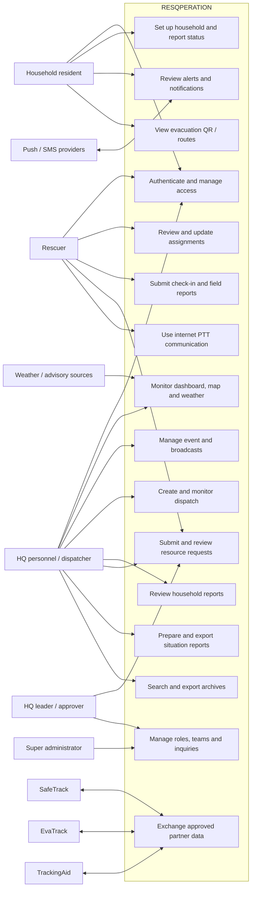
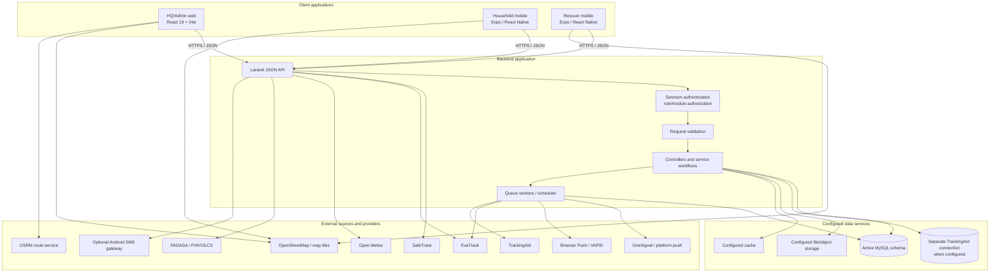

<p align="center">
<strong>UNIVERSITY OF SAN JOSE–RECOLETOS</strong><br>
School of Computer Studies<br>
Cebu City, Philippines
</p>

# RESQPERATION

## A Geo-Tagged Household Monitoring and Barangay Disaster Risk Reduction and Management Rescue Coordination System

### Software Requirements Specification

**Version 1.1 | October 22, 2026**

<p align="center">
A Capstone Project Presented to the Faculty of the<br>
School of Computer Studies<br>
University of San Jose–Recoletos<br><br>
In Partial Fulfillment of the Requirements for<br>
Associate in Computer Technology, Major in Software Development
</p>

**Presented by**

- Niña Kathleen B. Barro
- Vinzon Arellano
- Erece Joy Eria
- Vince Pacillan

**Capstone Adviser:** Mr. Roderick A. Bandalan

---

## Abstract

Barangay disaster response depends on timely situational information, coordinated assignments, and accountable communication among residents, responders, and local operations personnel. RESQPERATION is a multi-client capstone system designed to support these activities in Barangay Mambaling, Cebu City. This Software Requirements Specification (SRS) defines the system boundary, intended users, operational workflows, external interfaces, functional and quality requirements, data responsibilities, verification conditions, and known implementation limitations. The specification was prepared by reviewing project requirements materials, the use-case inventory, architecture and integration documentation, an implementation audit, and available application evidence. RESQPERATION comprises an HQ/Admin web client, household and rescuer mobile workflows, a Laravel application programming interface, a configured relational database, and optional external services. Its principal workflows include household status reporting, disaster-event coordination, responder assignment and field reporting, resource-request review, weather and map context, situation reporting, and incident archiving. The document distinguishes system requirements from implementation evidence and deployment-dependent integrations; it does not claim that the software is an official warning authority, a substitute for emergency services, or a validated predictor of safety or response outcomes. Operational acceptance remains subject to stakeholder review, security and privacy approval, deployment verification, and end-to-end testing.

**Keywords:** disaster response coordination, barangay, household monitoring, geotagging, rescue dispatch, software requirements specification

## Revision History

| Version | Date | Description | Author(s) |
| --- | --- | --- | --- |
| 1.0 | October 22, 2026 | Initial requirements baseline assembled from the project SRS template and current system documentation. | All proponents |
| 1.1 | October 22, 2026 | Reorganized as a formal capstone SRS; added academic front matter, project context, problem statement, objectives, requirements method, system flows, acceptance criteria, and evidence-qualified implementation status. | All proponents |

## Document Control

| Control field | Value |
| --- | --- |
| System | RESQPERATION: A Geo-Tagged Household Monitoring and Barangay Disaster Risk Reduction and Management Rescue Coordination System |
| Document | Software Requirements Specification, Version 1.1 |
| Document status | Draft requirements baseline submitted for adviser and panel review |
| Prepared by | Niña Kathleen B. Barro; Vinzon Arellano; Erece Joy Eria; Vince Pacillan |
| Reviewed by | Mr. Roderick A. Bandalan, Capstone Adviser |
| Approved by | To be completed after formal review |
| Date | October 22, 2026 |
| Initial deployment area | Barangay Mambaling, Cebu City, Philippines |

> This SRS is an academic requirements and design document. Statements of intended behavior are normative requirements; implementation status is reported separately and is not proof of production readiness, stakeholder acceptance, or legal compliance.

## Table of Contents

- [Abstract](#abstract)
- [Revision History](#revision-history)
- [Document Control](#document-control)
- [List of Figures](#list-of-figures)
- [Table of Contents](#table-of-contents)
1. [Introduction](#1-introduction)
   1. [Purpose](#11-purpose)
   2. [Project Background and Rationale](#12-project-background-and-rationale)
   3. [Problem Statement](#13-problem-statement)
   4. [Project Objectives](#14-project-objectives)
   5. [Scope and Limitations](#15-scope-and-limitations)
   6. [Requirements Engineering Method](#16-requirements-engineering-method)
   7. [Definitions, Acronyms, and Abbreviations](#17-definitions-acronyms-and-abbreviations)
   8. [References](#18-references)
   9. [Organization of the SRS](#19-organization-of-the-srs)
2. [Overall Description](#2-overall-description)
   1. [Product Perspective](#21-product-perspective)
   2. [Product Functions](#22-product-functions)
   3. [User Classes and Characteristics](#23-user-classes-and-characteristics)
   4. [Operating Environment](#24-operating-environment)
   5. [Design and Implementation Constraints](#25-design-and-implementation-constraints)
   6. [Assumptions and Dependencies](#26-assumptions-and-dependencies)
   7. [Apportioning of Requirements](#27-apportioning-of-requirements)
3. [Specific Requirements](#3-specific-requirements)
   1. [External Interface Requirements](#31-external-interface-requirements)
   2. [Functional Requirements](#32-functional-requirements)
   3. [Non-Functional Requirements](#33-non-functional-requirements)
   4. [Database Requirements](#34-database-requirements)
   5. [System Flows](#35-system-flows)
   6. [Verification and Acceptance](#36-verification-and-acceptance)
4. [Appendix A. Use Case Diagram](#appendix-a-use-case-diagram)
5. [Appendix B. Use Case Narratives](#appendix-b-use-case-narratives)
6. [Appendix C. System Architecture](#appendix-c-system-architecture)
7. [Appendix D. Entity-Relationship Diagram](#appendix-d-entity-relationship-diagram)
8. [Appendix E. User Interface Screenshot Placeholders](#appendix-e-user-interface-screenshot-placeholders)
9. [Appendix F. Requirements Traceability Summary](#appendix-f-requirements-traceability-summary)
10. [Appendix G. Implementation Status and Verification Evidence](#appendix-g-implementation-status-and-verification-evidence)
11. [Appendix H. Acceptance Criteria](#appendix-h-acceptance-criteria)
12. [Appendix I. Approval](#appendix-i-approval)

## List of Figures

| Figure | Caption |
| --- | --- |
| 1 | RESQPERATION use-case model and system boundary |
| 2 | RESQPERATION logical system architecture |
| 3 | RESQPERATION logical entity-relationship diagram |
| 4 | RESQPERATION web login screen |
| 5 | HQ/Admin dashboard and active incident overview |
| 6 | HQ/Admin map and household/responder layers |
| 7 | Household mobile home and current disaster alert |
| 8 | Household mobile status-reporting screen |
| 9 | Rescuer mobile assignment and navigation screen |
| 10 | HQ/Admin resource-request review and validation screen |
| 11 | Situation report / archive screen |

---

# 1. Introduction

## 1.1 Purpose

This Software Requirements Specification establishes the agreed subject, system boundary, actors, interfaces, functional requirements, quality requirements, data responsibilities, system flows, and acceptance conditions for RESQPERATION. Its primary audience is the capstone panel, adviser, project proponents, and any authorized stakeholder asked to review or validate the proposed system.

The SRS is intended to be used as (a) an academic description of the project’s requirements and design boundary, (b) a baseline for implementation and verification, and (c) a record of known implementation gaps requiring review. Normative statements use “shall.” The implementation-status appendix is informative and must not be interpreted as a substitute for test evidence or stakeholder acceptance.

## 1.2 Project Background and Rationale

Disaster response at the barangay level requires local officials and responders to receive, review, and act on information about affected households, responder assignments, evacuation activity, and resource needs. These activities may involve multiple user groups and data sources. RESQPERATION is proposed as a shared digital workspace that supports the recording and coordination of those workflows; it does not replace the decision-making authority of the barangay, city, or national disaster-risk-reduction and management offices.

The initial project setting is Barangay Mambaling in Cebu City. PhilAtlas reports a 2020 Census population of 30,459 and reports 7,583 households from the 2015 Census, with the underlying census figures attributed to the Philippine Statistics Authority [10]. The figures refer to different census years and are contextual references only; they are not current system records, a present-day population estimate, or a substitute for an authoritative barangay registry. Geographic susceptibility information included in the project is likewise a sourced planning layer, not a live sensor reading or a household-level risk determination [8].

The policy context includes the Philippine Disaster Risk Reduction and Management Act of 2010, which establishes national and local disaster-risk-reduction and management responsibilities [9]. RESQPERATION is designed to support coordination and information management within that broader institutional context. It is not an official warning issuer, dispatch authority, or emergency-service provider. Its privacy requirements are informed by the Data Privacy Act of 2012 [11]; reference to the law does not certify that the project or any deployment is legally compliant.

The project’s technical basis is documented in its system architecture, use cases, integration notes, and repository evidence [1–8]. The system aligns conceptually with Sustainable Development Goal 11 (sustainable cities and communities) and Goal 13 (climate action); the alignment is a project rationale, not an endorsement or verified social-impact outcome [12].

## 1.3 Problem Statement

The project addresses the requirements-design problem of coordinating disaster-related records and actions across household residents, field responders, and barangay headquarters using separate client workflows and data sources. Without a shared operational workflow, information submitted by one role may be difficult for another authorized role to locate, interpret, validate, or follow through.

Specifically, the system is intended to address the following information-management and coordination needs:

1. Household safety updates need to be associated with the correct household, member, event, source, and submission time so that authorized personnel can review the reported status.
2. Rescue assignments and field updates need a traceable link between the event, responder/team, target, assignment state, and subsequent report.
3. Requests for resources or personnel need a controlled intake and review process that distinguishes internal approval from an external handoff or actual fulfillment.
4. Weather, map, hazard, and advisory information needs clear source and freshness context so users do not confuse decision-support data with official local direction.
5. Situation reports and archives need to represent recorded information and missing data faithfully, while restricting personal and operational information to authorized users.

RESQPERATION’s requirements therefore focus on controlled data access, auditable workflows, explicit system/provider outcomes, and human review. The project does not claim—without a separate evaluation—that deploying the software will reduce casualties, guarantee rescue, improve response time, or independently resolve the operational challenges described above.

## 1.4 Project Objectives

### General objective

To specify and develop a role-based, multi-client barangay disaster-response coordination system for the initial project setting of Mambaling, Cebu City, with traceable workflows for household status reporting, responder operations, HQ coordination, resource requests, and incident documentation.

### Specific objectives

The system shall:

1. provide authenticated and role-authorized web and mobile workspaces for HQ/Admin personnel, household residents, and rescuers;
2. allow household users to view linked household information and submit event-related safety status for authorized household members;
3. allow HQ users to create and manage disaster events and broadcasts, review incoming status information, and coordinate responder assignments;
4. allow rescuers to review authorized assignments and submit supported progress, location, check-in, field-report, and resource-request information;
5. provide controlled request review and distinguish RESQPERATION approval and handoff from partner-system processing and fulfillment;
6. present map, weather, advisory, and hazard context with appropriate source attribution and limitations;
7. support the preparation, controlled exchange, retrieval, and archiving of situation reports and related operational records; and
8. define verifiable security, privacy, reliability, usability, data-integrity, and acceptance requirements for the stated scope.

These objectives describe intended system capabilities. They are not claims that every capability has passed acceptance testing or that the system has demonstrated a measurable disaster-response impact.

## 1.5 Scope and Limitations

RESQPERATION is a barangay disaster-response and emergency-operations coordination system initially scoped to Mambaling, Cebu City. Its project boundary comprises:

- **HQ/Admin web client:** event and broadcast administration, household-status review, dispatch, operational map and weather context, request validation, situation reporting, notifications, and archive workflows, subject to the user’s assigned permissions.
- **Household mobile workflows:** authentication, linked household/member views, household setup information, event-status submission and history, trusted-household features, and supported evacuation information.
- **Rescuer mobile workflows:** authentication, assignment access, supported location and progress updates, field check-ins and reports, resource requests, and internet-dependent team communication.
- **Application services:** a Laravel JSON API responsible for authentication, authorization, validation, business rules, and access to the active configured database.
- **External interfaces:** specifically configured household-data sharing, partner request/report exchange, weather/advisory sources, maps/routing, push notifications, and optional SMS services.

The system supports information management, coordination, and recordkeeping. It does not independently make emergency decisions, certify the accuracy of source data, or guarantee a response. The following are excluded from the current requirements baseline or remain unverified:

- ownership or replacement of SafeTrack household identity/census records, EvaTrack evacuation operations, or TrackingAid inventory and fulfillment;
- an official government warning function, authoritative hazard prediction, automatic optimal dispatch, or certified life-safety operation;
- guaranteed message delivery, route safety, uninterrupted availability, response time, rescue, or resource fulfillment;
- end-to-end household reporting and navigation during loss of connectivity beyond specifically tested capabilities;
- a complete dedicated evacuation-QR scanning/operator interface;
- automatic city or national agency receipt and acknowledgement unless a separate, verified integration is established;
- production deployment service-level commitments, formal operational-readiness certification, and legal/privacy compliance certification; and
- system-wide population statistics beyond the date-identified sources and authorized operational records.

The project is initially bounded to one barangay profile and the roles/workflows identified in this document. Expansion to other barangays, jurisdictions, mobile operating systems, or partner systems requires configuration, privacy and authority review, interface validation, and acceptance testing. External-provider access, partner credentials, network availability, and third-party service terms remain dependencies outside the project’s control.

## 1.6 Requirements Engineering Method

Requirements were consolidated from the supplied SRS template, the project README, the documented use cases, the implementation audit, architecture and integration materials, development checklist, and inspection of available application and backend evidence [1–8]. Requirements were grouped by user workflow and quality attribute, assigned unique identifiers, and written using testable “shall” statements where the expected behavior could be stated without prescribing an unnecessary implementation detail.

Each requirement’s implementation condition is recorded separately using the status vocabulary defined in Section 3.2. Status is evidence-qualified: source code or a route may demonstrate that an implementation exists, but does not by itself demonstrate usability, successful integration, production operation, or stakeholder acceptance. Verification is to use an appropriate combination of inspection, analysis, unit/feature tests, integration tests, device testing, and stakeholder acceptance.

This requirements baseline is based on document review and implementation inspection. No user survey, controlled field trial, performance benchmark, or measured outcome study is asserted by this SRS. Operational users and the project adviser should review unresolved assumptions and the acceptance criteria before the specification is treated as an approved baseline. Changes shall be versioned and their affected requirements, use cases, interfaces, tests, and diagrams updated together.

## 1.7 Definitions, Acronyms, and Abbreviations

| Term | Definition |
| --- | --- |
| API | Application Programming Interface used by web/mobile clients and approved partner systems. |
| Barangay | The local government unit targeted by this system; the initial project area is Mambaling, Cebu City. |
| BDRRM | Barangay Disaster Risk Reduction and Management. |
| BDRRMC | Barangay Disaster Risk Reduction and Management Committee. |
| CAP | Common Alerting Protocol, a structured format used by public alert feeds. |
| CRUD | Create, Read, Update, and Delete data operations. |
| ERD | Entity-Relationship Diagram showing data entities and their relationships. |
| GeoTag | Geographic coordinates associated with a household, responder, site, or operational record. |
| HQ/Admin | Authorized barangay headquarters personnel using the web operations workspace. |
| MySQL | Relational database management system used by the configured operational database. |
| ODbL | Open Database License, applicable to OpenStreetMap database data. |
| PII | Personally identifiable information. |
| PTT | Push-to-talk style communication. The documented project feature is internet-dependent and is not a hardware radio. |
| RBAC | Role-Based Access Control; permissions are associated with user roles and module/action policy. |
| RESQPERATION | The Geo-Tagged Household Monitoring and Barangay Disaster Risk Reduction and Management Rescue Coordination System specified in this document. |
| SRS | Software Requirements Specification. |
| SitRep | Situation Report, a structured summary of incident conditions and response. |
| SMS | Short Message Service. |
| UAT | User Acceptance Testing. |
| UI | User Interface. |
| Use case | A description of an actor's goal and the system interactions that accomplish or reject it. |
| VAPID | Voluntary Application Server Identification, used to identify an application server for browser push. |

## 1.8 References

### Project documents and evidence

1. RESQPERATION project team. (2026). [Project README](../README.md) [Project document].
2. RESQPERATION project team. (2026, October 20). [System use cases](USE_CASES.md) [Project document].
3. RESQPERATION project team. (2026, October 20). [Must-Haves implementation audit](MUST_HAVES_IMPLEMENTATION_AUDIT.md) [Project audit].
4. RESQPERATION project team. (2026). System architecture and file-stack documentation; the architecture view is included in [Appendix C](#appendix-c-system-architecture).
5. RESQPERATION project team. (2026). Development checklist [Project planning document maintained outside the application repository; entries are dated and may not reflect later work].
6. RESQPERATION project team. (2026). Workspace documentation index and diagram catalogue [Project documents maintained outside the application repository].
7. RESQPERATION project team. (2026). [Mambaling hazard source notes](MAMBALING_HAZARD_SOURCES.md) [Project source notes].
8. RESQPERATION project team. (2026). [Offline navigation notes](OFFLINE_NAVIGATION.md) and [progress record](OFFLINE_NAVIGATION_PROGRESS.md) [Project documents].

### Standards, laws, and external technical sources

9. Republic of the Philippines. (2010). *Republic Act No. 10121: Philippine Disaster Risk Reduction and Management Act of 2010*. [Official Senate legislative reference](https://issuances-library.senate.gov.ph/legislative%2Bissuances/Republic%20Act%20No.%2010121).
10. PhilAtlas. (n.d.). [Mambaling, Cebu City](https://www.philatlas.com/visayas/r07/cebu-city/mambaling.html). Census statistics reported from the Philippine Statistics Authority; population and household figures in this SRS retain their respective census years. Retrieved October 22, 2026.
11. Republic of the Philippines. (2012). *Republic Act No. 10173: Data Privacy Act of 2012*. [National Privacy Commission reference](https://privacy.gov.ph/data-privacy-act/). Cited as a design and governance reference, not as evidence of compliance.
12. United Nations. (n.d.). [Sustainable Development Goals: Goals 11 and 13](https://sdgs.un.org/goals). Retrieved October 22, 2026.
13. ISO/IEC/IEEE. (2018). *ISO/IEC/IEEE 29148:2018: Systems and software engineering — Life cycle processes — Requirements engineering*.
14. IEEE. (1998). *IEEE Std 830-1998: Recommended Practice for Software Requirements Specifications*. Legacy structural reference.
15. OWASP Foundation. (n.d.). [Application Security Verification Standard](https://owasp.org/www-project-application-security-verification-standard/) and [OWASP Top 10](https://owasp.org/www-project-top-ten/). Retrieved October 22, 2026.
16. Laravel. (n.d.). [Documentation](https://laravel.com/docs); Meta. (n.d.). [React documentation](https://react.dev/); Expo. (n.d.). [Documentation](https://docs.expo.dev/); Oracle. (n.d.). [MySQL reference manual](https://dev.mysql.com/doc/). Retrieved October 22, 2026.
17. Open-Meteo. (n.d.). [API documentation](https://open-meteo.com/en/docs), [licence](https://open-meteo.com/en/licence), and [terms](https://open-meteo.com/en/terms). Retrieved October 22, 2026.
18. Department of Science and Technology–Philippine Atmospheric, Geophysical and Astronomical Services Administration. (n.d.). [Public alert feeds](https://publicalert.pagasa.dost.gov.ph/feeds/) and [products and services](https://pagasa.dost.gov.ph/products-and-services). Retrieved October 22, 2026.
19. OpenStreetMap Foundation. (n.d.). [Copyright and ODbL attribution](https://www.openstreetmap.org/copyright) and [tile usage policy](https://operations.osmfoundation.org/policies/tiles/). Retrieved October 22, 2026.

Project documents [1–8] describe the project-specific requirements and evidence. External standards, laws, and service documentation [9–19] provide contextual or technical references. The project’s broader review of related literature and studies belongs in the capstone manuscript’s literature-review chapter and is not replaced by this engineering specification.

## 1.9 Organization of the SRS

Section 1 establishes the project context, problem, objectives, scope, and requirements method. Section 2 defines product perspective, functions, users, operating environment, constraints, assumptions, and requirement allocation. Section 3 specifies external interfaces, functional and non-functional requirements, database expectations, operational flows, and verification and acceptance. Appendices A–E provide the use-case diagram and narratives, system architecture, logical ERD, and screenshot placeholders. Appendix F traces requirement groups to use cases. Appendices G–I record evidence-qualified implementation status, acceptance criteria, and approval.

# 2. Overall Description

## 2.1 Product Perspective

RESQPERATION is a multi-client system that coordinates work across authorized HQ/Admin users and mobile household/rescuer users. The web and mobile clients call a Laravel JSON API; they must not connect directly to the operational database. Laravel applies authentication, validation, role/module permission checks, and workflow rules before reading or writing records.

The system uses an active MySQL connection selected through backend environment configuration. Household identity/member information may be shared with SafeTrack. RESQPERATION records its operational workflows and may communicate with EvaTrack and TrackingAid using configured API or database handoff mechanisms. External systems remain separate systems of record for their own domains.

### Product context

```text
HQ/Admin browser ──┐
                   ├── HTTPS/JSON ── Laravel API ── Active MySQL database
Household mobile ──┤                       ├────── Weather/advisory sources
Rescuer mobile ────┘                       ├────── Push/SMS services
                                           ├────── Map/routing services
                                           └────── Partner systems
```

The system's main operating boundary includes:

- RESQPERATION web, mobile, backend, and owned operational workflows.
- Shared database records that the project is explicitly authorized to read or update.
- External services that supply data, deliver messages, calculate routes, or exchange records.

It does not claim ownership of partner databases, government source data, map data, or provider availability.

## 2.2 Product Functions

At a summary level, RESQPERATION shall provide:

1. Account authentication, role-aware routing, authorization, session/token handling, and profile maintenance.
2. HQ/Admin event dashboards, event lifecycle actions, broadcasts, and household/responder monitoring.
3. Household first-run setup, linked household/member views, status submission, history, trusted-household functions, and supported evacuation features.
4. Rescuer assignment access, navigation, operational status/location updates, field reports, requests, and internet-based radio communication.
5. Map views showing available households, sites, responders, routes, and sourced hazard overlays.
6. Weather snapshots and official advisory references, with provider/source labels.
7. Request intake and HQ review, validation, return, forwarding, and tracking.
8. Situation report generation, partner report exchange, exports, and incident archives.
9. Mobile and browser notification registration and delivery when providers, permissions, and connectivity allow.
10. Auditability, validation, bounded data access, and explicit error handling for supported operations.

## 2.3 User Classes and Characteristics

| User class | Access channel | Characteristics and primary responsibilities |
| --- | --- | --- |
| Household resident | Android/mobile app | Uses linked household credentials; may have limited technical experience and may operate under stressful conditions or intermittent connectivity. Views alerts and submits household/member reports. |
| Rescuer | Android/mobile app | Uses an authorized rescuer account/device. Reviews assignments, navigates, reports field information, requests resources, and communicates with the team. |
| HQ personnel / dispatcher | Web app | Uses role-authorized operational modules to monitor events, households, dispatch, field activity, and reports. Access varies by configured permissions. |
| HQ leader / approver | Web app | Performs permitted request approvals, personnel/role administration, and incident coordination. Approval rights are separately enforced. |
| Super administrator | Web app | Performs system-level administration and inquiry management where enabled. |
| External partner system | Server-to-server API or configured connection | Uses integration-specific credentials and contracts. It is not a human UI role; external access must not inherit web-user permissions. |
| Evacuation verifier | Intended HQ/rescuer workflow | Backend verification endpoints exist, but a complete dedicated scanner/operator UI is not established. This is not specified as a separate account role. |

## 2.4 Operating Environment

### Backend

- PHP 8.3 or compatible supported version.
- Laravel 13 API application.
- MySQL database using the active approved schema.
- Configured queue workers, scheduler, cache, and storage where required by enabled workflows.
- A network endpoint reachable by web clients, mobile devices, and configured partners.

### Web client

- React 19 and Vite 8 application.
- Current desktop-class browser with JavaScript enabled.
- HTTPS is required for browser Push and service-worker behavior outside localhost.

### Mobile client

- Expo SDK 54 / React Native application.
- Android device for the verified standalone APK workflow; iOS support depends on a separately configured build and provider setup.
- Location permission, notification permission, GPS hardware, storage, and network are required only for features that use them.
- OneSignal/native map functionality requires a development or production build, not ordinary Expo Go.

### Network and providers

- Clients require IP connectivity to the API for server-backed operations.
- LAN/Tailscale or another securely managed network may be used during development/deployment.
- Weather, maps, routing, external partner, SMS, and notification functions depend on their respective service reachability and terms.

## 2.5 Design and Implementation Constraints

1. Laravel is a JSON API; the HQ/Admin user interface is a separate React web application.
2. Web and mobile clients shall use API contracts and shall not access MySQL directly.
3. API authentication uses Laravel Sanctum or the configured external integration authentication.
4. Role and module/action permissions shall be evaluated by the backend; hiding a menu item is not sufficient authorization.
5. The operational database is shared/externally governed. Destructive rebuilds, unreviewed migrations, destructive seeders, and credential exposure are prohibited.
6. The active database connection shall be configurable using local backend environment configuration. TrackingAid access, if enabled, shall use separate configuration.
7. The application shall display real records from the configured data source and shall not present fabricated fallback values as operational data.
8. Public forecast, tile, and routing endpoints have provider limits and are not guaranteed emergency-grade services.
9. External credentials, private signing keys, database credentials, and push tokens shall not be committed in source or public documentation.
10. Geographic layers must retain provenance and limitations. A susceptibility raster/polygon is not a live sensor or a guarantee of safety.
11. Offline support shall only be claimed for the specific workflows and device configurations that have been validated.
12. The product is a capstone coordination aid, not a certified emergency dispatch, warning, or life-safety system.

## 2.6 Assumptions and Dependencies

- Users have valid accounts provisioned in the active database or through an approved account workflow.
- Household users are linked to authorized household/member records; RESQPERATION does not independently establish the authoritative census.
- Operational data is accurate enough for the intended workflow and is maintained by authorized sources/operators.
- The backend, active database, network, queue workers, and scheduled tasks are available for workflows that rely on them.
- Push delivery requires valid provider configuration, a subscribed device, permission, network access, and a supported app build.
- The Open-Meteo free API is subject to non-commercial use limits and CC BY 4.0 attribution; deployment owners must review current terms.
- PAGASA and PHIVOLCS publish official information; operators remain responsible for interpretation and local decision-making.
- OpenStreetMap base map data and tile service are distinct: OSM data attribution/licence and tile usage policies both apply.
- Partner endpoints, schemas, credentials, and service uptime are outside RESQPERATION's control.
- Mambaling census statistics in project documentation are dated census references, not live household counts.
- Operators are trained and retain authority to verify, correct, or reject system-generated or partner-supplied information.

## 2.7 Apportioning of Requirements

Requirements are apportioned across the following releases/work areas:

| Release/work area | Allocation |
| --- | --- |
| Version 1 operational core | Authenticated HQ/Admin web modules, household/rescuer mobile entry, disaster/status workflows, mapping/weather context, dispatch, request review, reports, and archives. |
| Version 1 conditional integrations | OneSignal/mobile push, browser push, SMS gateway, external report exchange, and TrackingAid handoff; acceptance depends on deployment configuration and reachable partners. |
| Partial capabilities to complete | Dedicated evacuation verification UI, verified full offline household status reporting, deployment-complete offline navigation, end-to-end partner fulfillment acceptance, and issues identified in the latest audit. |
| Future extensions | Additional barangays and deployment profiles, formal service-level targets, broader agency integrations, verified persistent offline workflows, and any production certification required by stakeholders. |

Priorities and release dates are subject to adviser and stakeholder approval. No future capability is implied to be present merely because it appears in this allocation.

# 3. Specific Requirements

**Requirement notation:** Each requirement has a unique identifier and uses “shall” for a normative system obligation. The status column is implementation evidence, not part of the normative requirement. Status values are **Implemented**, **Partial**, **Conditional**, **Proposed**, or **Not independently verified** and summarize the evidence reviewed in the October 20, 2026 implementation audit [3]. They do not certify the state of a later build, a deployment, user acceptance, or a live partner connection. Appendix G explains the evidence limitations.

## 3.1 External Interface Requirements

### 3.1.1 User Interfaces

#### Web interface

- The web application shall present a role-authorized HQ/Admin workspace for dashboards, disaster events and broadcasts, weather, maps, household status, dispatch, rescuer/team management, resources/requests, situation reports, archives, notifications, and profile actions where permission is granted.
- The application shall display loading, empty, success, and error states distinctly.
- Tables and large collections shall provide supported search/filter/pagination rather than requiring all operational records to be loaded at once.
- The interface shall show the source and status of external data where material to interpretation.
- Destructive or consequential actions shall use an explicit confirmation or review step appropriate to the operation.

#### Household mobile interface

- The mobile application shall provide household login and role-specific routing.
- First-run setup shall clearly communicate the location data required by enabled household features and request OS permission before using device location.
- Current alerts, household/member context, status choices, submission result, and available history shall be visible without relying on fabricated telemetry or status.
- The application shall show when a submission is pending, rejected, or saved; it shall not imply server synchronization on network failure.
- Household location, battery, network, and notification indicators shall be shown only when obtained from the corresponding device or server source.

#### Rescuer mobile interface

- The mobile application shall provide rescuer login and role-specific access.
- Assignment details, navigation status, field-report forms, request workflow, radio controls, and network/location state shall be presented according to the rescuer's authorization.
- The application shall distinguish online/available route data from locally cached/offline data.
- The application shall not label internet voice communication as offline hardware radio.

#### Screenshot evidence placeholders

Actual screenshot files are intentionally not embedded in this draft. Figure placeholders are provided in [Appendix E](#appendix-e-user-interface-screenshot-placeholders) for the project team to replace or accompany with screenshots.

### 3.1.2 Hardware Interfaces

- The system shall use a compatible server or development computer to host the Laravel API and configured supporting services.
- Mobile location functions shall interface with device GPS/location services only after applicable OS permission.
- Mobile notification delivery shall interface with supported Android/iOS notification facilities through the configured provider SDK.
- Camera access may be used for QR scanning only when the scanning interface is implemented and permission is granted.
- Optional SMS transport shall interface with a configured Android gateway phone and SIM/carrier service; this hardware is not mandatory for core web/mobile use.
- The system shall degrade gracefully if GPS, camera, notification hardware, or a gateway device is unavailable.

### 3.1.3 Software Interfaces

| Interface | Protocol / data | Purpose | Boundary / status |
| --- | --- | --- | --- |
| Web and mobile clients ↔ Laravel API | HTTPS, JSON, REST-style routes, Sanctum token | Authentication and operational workflows. | Core system interface. |
| Laravel ↔ active MySQL database | MySQL driver through Laravel data access | Operational and framework persistence. | Schema is governed; use approved database configuration. |
| Laravel ↔ TrackingAid database/API | Separately configured database/API handoff | Forward validated resource requests and reconcile status where supported. | Conditional on partner availability and configuration. |
| Laravel ↔ SafeTrack | Shared data/partner interface | Household identity and agreed household/report exchanges. | Partner remains source of its domain data. |
| Laravel ↔ EvaTrack | Authenticated JSON API | External request intake and report exchange. | Live partner endpoint must be verified separately. |
| Laravel ↔ Open-Meteo | HTTPS weather API | Forecast snapshots. | Forecast provider, not an official warning authority. |
| Laravel ↔ PAGASA/PHIVOLCS | Public advisory feeds and source links | Official-source advisory context. | Display/update depends on source availability and current integration. |
| Web/mobile ↔ OpenStreetMap and map services | HTTPS tile/vector/map requests | Base maps and geographic display. | Attribution and usage policy apply. |
| Web ↔ OSRM public demo | HTTPS route request/GeoJSON | On-demand route geometry. | Public demo, no mission-critical availability guarantee. |
| Laravel/mobile ↔ OneSignal and platform push | HTTPS REST/SDK and native push services | Mobile push subscription and delivery. | Requires private credentials, permission, subscription, and network. |
| Web browser ↔ Web Push service | Service Worker, Push API, VAPID | Browser notification subscription/delivery. | Secure origin and supported browser required. |
| Laravel ↔ SMS Gateway for Android | HTTPS/local gateway API and signed webhook | Optional inbound/outbound SMS workflow. | Optional; carrier and network dependencies apply. |

API keys and private credentials shall be supplied through protected runtime configuration and shall not appear in this SRS.

### 3.1.4 Communications Interfaces

- Client-server communication shall use HTTPS in deployed environments. Local development may use explicitly configured localhost/LAN endpoints, with no claim of production security for plain HTTP.
- REST API requests shall use JSON for supported request/response bodies and appropriate HTTP status codes for success, validation failure, authorization failure, and service failure.
- Authenticated application requests shall carry the configured bearer token using the API's supported authentication mechanism.
- Partner API calls shall use partner-specific credentials and documented versioned contracts; credentials for different partner functions shall not be conflated.
- WebSocket/realtime channels, queues, push, and scheduled jobs shall be treated as optional supporting communication paths. The application shall retain a defined refresh/failure behavior if realtime delivery is unavailable.
- SMS webhooks shall be authenticated and validated according to the configured gateway signature/timestamp contract.
- The application shall not log secrets or full authentication tokens in normal operational logs.

## 3.2 Functional Requirements

### 3.2.1 Authentication and User Management (AUTH)

| ID | Requirement | Status |
| --- | --- | --- |
| AUTH-001 | The system shall authenticate a user against a valid account identifier and password before granting a protected session. | Implemented |
| AUTH-002 | The system shall identify the user's role and route the session to only the authorized web or mobile workspace. | Implemented |
| AUTH-003 | The system shall deny access for invalid credentials, inactive accounts, missing required household linkage, unauthorized device state, or failed network authentication. | Implemented |
| AUTH-004 | The system shall authorize each protected API action on the backend using authentication, role, module, and action rules as applicable. | Implemented |
| AUTH-005 | The system shall allow an authenticated user to retrieve their current identity and end their session. | Implemented |
| AUTH-006 | The system shall allow users to view and update permitted profile fields and change their password according to configured policy. | Implemented |
| AUTH-007 | The system shall support configured account-recovery questions and verification before resetting a password. | Conditional on recovery setup |
| AUTH-008 | The system shall allow authorized administrators to manage supported rescuer accounts, teams, HQ accounts, roles, module access, and approval rights. | Partial; some registration verification fields/workflows are not established |
| AUTH-009 | The system shall maintain an audit trail for supported privileged account and operational changes. | Implemented for documented audited actions |
| AUTH-010 | The system shall rate-limit selected authentication and public/external write endpoints to reduce automated abuse. | Implemented; thresholds are route-specific |

### 3.2.2 Household Records and Mobile Reporting (HOU)

| ID | Requirement | Status |
| --- | --- | --- |
| HOU-001 | The system shall display household and member records linked to the authenticated household account. | Implemented |
| HOU-002 | The system shall guide the resident through required first-run household setup and capture an address/geotag only with permission or user input. | Implemented |
| HOU-003 | The system shall allow a household resident to view current household/member information and supported profile details. | Implemented |
| HOU-004 | The system shall display the applicable active disaster alert and status choices supplied by the backend. | Implemented |
| HOU-005 | The system shall accept an authorized household/member safety-status submission only when identifiers and status are valid for the applicable event/broadcast. | Implemented |
| HOU-006 | The system shall record accepted status updates with household/member/event context and submission time, and make them available to authorized HQ users. | Implemented |
| HOU-007 | The system shall allow residents to view available status history. | Implemented |
| HOU-008 | The system shall permit a resident to connect to or report for a trusted household only after required lookup, connection, PIN, and authorization checks succeed. | Implemented |
| HOU-009 | The system shall display a household evacuation QR payload for supported evacuation workflows. | Implemented |
| HOU-010 | The system shall provide backend QR verification/check-in operations only to authorized users and valid center/event records. | Partial; dedicated operator scan/entry UI is not established |
| HOU-011 | The system shall report location, battery, and network information only when the corresponding value is available from a trusted source. | Implemented |
| HOU-012 | The system shall communicate failed or unsynchronized status submissions without indicating successful server persistence. | Implemented by online request handling; durable household offline outbox is not established |
| HOU-013 | The system shall support persistent offline household overview caching and durable status submission for later synchronization. | Proposed; not established |

### 3.2.3 Rescuer Operations (RES)

| ID | Requirement | Status |
| --- | --- | --- |
| RES-001 | The system shall allow an authenticated rescuer to view only assignments and household information permitted for that rescuer. | Implemented |
| RES-002 | The system shall allow a rescuer to view the assignment target, relevant household details, and available route information. | Implemented online |
| RES-003 | The system shall allow an authorized rescuer to update supported assignment status and operational location. | Implemented; connectivity required |
| RES-004 | The system shall record supported household check-ins and member assessment information with event/assignment context. | Implemented |
| RES-005 | The system shall accept authorized field reports, including supported findings, notes, timestamps, and damage/injury information. | Implemented |
| RES-006 | The system shall allow a rescuer to submit a resource/personnel request and show its recorded state. | Partial; current audit reports an urgency persistence issue requiring verification |
| RES-007 | The system shall allow rescuers to use the implemented internet-connected PTT/radio clip workflow when service and permissions are available. | Implemented online; not offline radio |
| RES-008 | The system shall display available GPS/route status and shall not claim a route is safe or guaranteed. | Implemented |
| RES-009 | The system shall allow compatible offline map/route packs and trip synchronization for configured rescuer devices. | Partial; deployment, asset reachability, cached route and physical offline tests remain |
| RES-010 | The system shall queue and later synchronize all eligible offline field submissions without loss or duplication. | Proposed/partial; durable support is not established for all operations |

### 3.2.4 HQ Operations, Disaster Management, and Mapping (OPS)

| ID | Requirement | Status |
| --- | --- | --- |
| OPS-001 | The system shall present authorized HQ users with dashboard summaries and recent operational activity from the active data source. | Implemented |
| OPS-002 | The system shall allow authorized users to create, view, update, and close disaster events under configured business rules. | Implemented |
| OPS-003 | The system shall allow authorized users to create event-scoped broadcasts with target scope, instructions, and configured household status choices. | Implemented |
| OPS-004 | The system shall allow HQ users to review household status, available location, status history, and relevant household details. | Implemented |
| OPS-005 | The system shall allow authorized HQ users to confirm/review household status without providing an unauthorized manual status edit path. | Implemented |
| OPS-006 | The system shall allow authorized HQ users to create and monitor rescuer/team assignments and supported assignment state transitions. | Implemented |
| OPS-007 | The system shall display available household, evacuation-site, team/responder, route, and hazard layers on supported maps. | Implemented with provider/data limitations |
| OPS-008 | The system shall preserve source attribution, source date, and interpretation limits for imported hazard layers. | Implemented in hazard documentation; verify with each layer |
| OPS-009 | The system shall retrieve and store configured weather snapshots and display their provider/source and observation/forecast context. | Implemented |
| OPS-010 | The system shall distinguish forecast-provider data from official warning authority and direct operators to confirm official warnings through PAGASA/appropriate authority. | Implemented |
| OPS-011 | The system shall display official advisory content only when obtained through an enabled official-source feed or link and shall preserve its source/time/expiry context where supplied. | Conditional on configured feed and upstream availability |
| OPS-012 | The system shall support map/routing failures by showing unavailable/error state rather than representing a missing route as safe. | Not independently verified |
| OPS-013 | The system shall not claim automatic optimal dispatch, official severity classification per affected area, or complete exposure analysis unless implemented and validated. | Not independently verified |

### 3.2.5 Resource Requests and Partner Exchange (REQ)

| ID | Requirement | Status |
| --- | --- | --- |
| REQ-001 | The system shall allow eligible internal users and configured external partners to submit resource/personnel requests with required validated fields. | Implemented |
| REQ-002 | The system shall record request source, event/location context, requested items/personnel, urgency, status, and audit information where supported by the schema. | Partial; audit identified urgency persistence regression for mobile submissions |
| REQ-003 | The system shall allow only an authorized approver to validate, return, reject/cancel, or complete supported request transitions. | Implemented |
| REQ-004 | The system shall forward only validated requests to the configured TrackingAid handoff. | Implemented workflow; partner delivery conditional |
| REQ-005 | The system shall preserve a durable retryable record for handoff synchronization where configured and shall not report failed synchronization as successful fulfillment. | Implemented/conditional on workers and partner connectivity |
| REQ-006 | The system shall provide authenticated external resource-request intake with an integration-specific credential and validation. | Implemented |
| REQ-007 | The system shall map request states to clear operational meanings such as pending review, validated, forwarded/in progress, and fulfilled/completed. | Implemented |
| REQ-008 | The system shall not claim TrackingAid fulfillment or partner end-to-end acceptance until confirmed by the supported partner workflow. | Not independently verified |
| REQ-009 | The system shall support external report request review, manual accept/reject, frozen report snapshots, signed status/download links, and configured file renewal. | Implemented for local contract; partner acceptance conditional |
| REQ-010 | The system shall keep resource-intake and report-exchange authentication scopes separate. | Implemented |

### 3.2.6 Situation Reports, Exports, and Archives (REP)

| ID | Requirement | Status |
| --- | --- | --- |
| REP-001 | The system shall generate situation reports from available event-scoped operational data and configured partner findings. | Implemented; partner data conditional |
| REP-002 | The system shall preserve a report snapshot when a report is saved/locked where that workflow applies. | Implemented |
| REP-003 | The system shall represent unknown/unavailable data as unknown or unavailable and shall not invent values to complete a report. | Not independently verified |
| REP-004 | The system shall support the defined situation-report sections and available formats (PDF, CSV, XLSX) according to the authorized workflow. | Implemented for documented report flows |
| REP-005 | The system shall allow an authorized operator to review an external report request and decide whether to release a report. | Implemented |
| REP-006 | The system shall provide event, household status, dispatch, request, situation-report, and other supported archive views with search/filter/pagination. | Partial; one legacy-admin authorization contract needs reconciliation |
| REP-007 | The system shall export only records allowed by the user's authorization and selected scope. | Implemented by documented access policy; validate per role |
| REP-008 | The system shall preserve a distinction between generating/downloading a report and external agency receipt/acknowledgement. | Not independently verified |

### 3.2.7 Notifications and Communications (NOT)

| ID | Requirement | Status |
| --- | --- | --- |
| NOT-001 | The system shall present role-scoped in-app notifications for supported operational events. | Implemented |
| NOT-002 | The system shall register mobile push subscriptions when the user, device, app build, permission, and provider configuration permit. | Conditional |
| NOT-003 | The system shall send supported broadcast/dispatch notifications through configured OneSignal services. | Conditional; provider acceptance does not establish device display |
| NOT-004 | The system shall support browser push registration and delivery on supported secure browser origins when configured. | Conditional |
| NOT-005 | The system shall use the configured SMS gateway for supported SMS workflows only when gateway credentials, network, device, and carrier service are available. | Optional/conditional |
| NOT-006 | The system shall distinguish message submission/provider acceptance from delivery/receipt by a person. | Not independently verified |
| NOT-007 | The system shall not disclose records from unauthorized modules through notification content or links. | Not independently verified |
| NOT-008 | The system shall provide a recoverable refresh/fallback path when realtime notification infrastructure is unavailable. | Implemented for documented areas |

### 3.2.8 Audit, Administration, and System Health (ADM)

| ID | Requirement | Status |
| --- | --- | --- |
| ADM-001 | The system shall validate user input and reject unauthorized or invalid writes with an explicit response. | Implemented |
| ADM-002 | The system shall maintain audit records for supported high-impact actions and state transitions. | Implemented for documented workflows |
| ADM-003 | The system shall provide health/readiness endpoints for operational monitoring without exposing secrets. | Implemented |
| ADM-004 | The system shall support configured scheduled/queued work for weather refresh, notification delivery, partner synchronization, and other enabled jobs. | Conditional on deployment |
| ADM-005 | The system shall allow authorized super administrators to review and manage supported inquiries. | Implemented |
| ADM-006 | The system shall protect secrets through local/private environment configuration and shall avoid returning secrets in client responses. | Not independently verified |

## 3.3 Non-Functional Requirements

### 3.3.1 Performance

| ID | Requirement | Verification |
| --- | --- | --- |
| NFR-PER-001 | Normal list and dashboard queries shall use server-side filtering/pagination or bounded summaries for potentially large collections. | Inspect API/query behavior and test a representative large dataset. |
| NFR-PER-002 | The application shall show a visible loading state while waiting for an asynchronous operation and a completion/error state when it ends. | UI acceptance test for representative modules. |
| NFR-PER-003 | External provider calls shall have configured timeouts and shall not block the client indefinitely. | Inspect configuration and simulate provider delay/outage. |
| NFR-PER-004 | Performance acceptance targets (response-time percentile, concurrent users, and dataset size) shall be approved and recorded before production deployment. | Signed performance test plan and test report. |

### 3.3.2 Security

| ID | Requirement | Verification |
| --- | --- | --- |
| NFR-SEC-001 | Protected API routes shall require valid authentication and shall enforce backend authorization for each operation. | Automated positive and negative role tests. |
| NFR-SEC-002 | Passwords shall be stored and verified using a suitable one-way password-hashing mechanism; plaintext passwords shall not be stored. | Review framework configuration and database handling. |
| NFR-SEC-003 | Secrets, tokens, passwords, and private keys shall not be embedded in public source, committed documentation, client bundles, or ordinary logs. | Secret scanning and source/configuration review. |
| NFR-SEC-004 | Deployed browser and client-server traffic shall use HTTPS; insecure remote origins shall not be used for browser Push. | Deployment and browser-origin checks. |
| NFR-SEC-005 | Inputs shall be validated and query operations shall avoid unsafe string-built SQL. | Automated validation tests and code review. |
| NFR-SEC-006 | Public and external write endpoints shall use appropriate authentication, authorization, rate limiting, and replay/expiry controls for their contract. | Endpoint-specific security tests. |
| NFR-SEC-007 | Operational data shall be exposed according to least privilege and role/module scope. | Authorization matrix tests. |

### 3.3.3 Reliability and Availability

| ID | Requirement | Verification |
| --- | --- | --- |
| NFR-REL-001 | API and provider failures shall be surfaced as errors or unavailable/stale states, not success-shaped fallback data. | Simulate database, provider, queue, and network failures. |
| NFR-REL-002 | Queued/retryable operations shall preserve enough state to identify failure and retry without claiming downstream completion prematurely. | Worker failure/retry test. |
| NFR-REL-003 | Data-changing operations shall use transactions or equivalent consistency controls where multi-record atomicity is required. | Review workflow and failure-injection tests. |
| NFR-REL-004 | Backups and recovery objectives (RPO/RTO) shall be defined by the deployment/data owner before production use. | Approved operational backup/recovery plan. |
| NFR-REL-005 | Availability and delivery guarantees shall not exceed those of the hosting network, database, devices, and configured third-party providers. | Deployment review. |

### 3.3.4 Usability

| ID | Requirement | Verification |
| --- | --- | --- |
| NFR-USA-001 | Core household and rescuer actions shall use concise, consistent labels and present the primary task before secondary information. | Representative task-based usability review. |
| NFR-USA-002 | Status, urgency, assignment, and notification meaning shall not be conveyed by color alone. | UI inspection and accessibility test. |
| NFR-USA-003 | Forms shall identify required fields, validation errors, and the outcome of submission. | Form acceptance tests. |
| NFR-USA-004 | User-facing language shall distinguish verified operational records, external reports, forecasts, advisories, estimates, and missing data. | Content review. |
| NFR-USA-005 | Mobile layouts shall support common Android screen sizes and touch operation for the tested device set. | Physical-device and emulator test matrix. |

### 3.3.5 Maintainability

| ID | Requirement | Verification |
| --- | --- | --- |
| NFR-MNT-001 | Backend business workflows shall remain separated from HTTP controllers sufficiently to support isolated testing and reuse. | Architecture/code review. |
| NFR-MNT-002 | API contracts, integration configuration, and module-specific setup shall be documented with the relevant source modules. | Documentation review. |
| NFR-MNT-003 | Automated tests shall cover security-sensitive authorization, status transitions, request workflows, and external failure behavior. | Test inventory and CI/test report. |
| NFR-MNT-004 | Database schema changes shall be reviewed and compatible with the active governed schema before deployment. | Migration/schema review. |
| NFR-MNT-005 | Dependencies and external APIs shall be periodically reviewed for supported versions, security advisories, and terms changes. | Periodic dependency/source review. |

### 3.3.6 Portability

| ID | Requirement | Verification |
| --- | --- | --- |
| NFR-POR-001 | Backend environment-specific values shall be externalized from source code. | Configuration review. |
| NFR-POR-002 | Mobile app builds shall support the documented target OS/device profile and declare native-feature requirements. | Build/install test on documented target. |
| NFR-POR-003 | The system shall not assume localhost is reachable from a physical mobile device or external partner. | Network configuration test. |
| NFR-POR-004 | A deployment shall document supported PHP, database, browser, and mobile OS versions. | Deployment manifest/release checklist. |

### 3.3.7 Data Privacy and Compliance

| ID | Requirement | Verification |
| --- | --- | --- |
| NFR-PRI-001 | The system shall collect and process location, household, member, and device data only for documented operational purposes and authorized workflows. | Data inventory and permission review. |
| NFR-PRI-002 | Location permission shall be requested through the platform mechanism, and denial/unavailable location shall not be replaced with fabricated coordinates. | Device permission tests. |
| NFR-PRI-003 | Access to personal and household records shall be role-restricted and auditable for supported actions. | Authorization and audit review. |
| NFR-PRI-004 | Data retention, correction, deletion, consent/notice wording, incident response, and data-subject request procedures shall be approved by the data controller before production use. | Approved privacy/governance documents. |
| NFR-PRI-005 | The system shall not claim Data Privacy Act compliance solely because these requirements appear in this SRS. | Review project claims and deployment approvals. |

## 3.4 Database Requirements

### 3.4.1 Data store and ownership

- The operational database shall be the active database selected by protected backend configuration.
- The database schema is shared/externally governed; RESQPERATION shall not assume it can rebuild, drop, or rename partner-owned tables.
- Laravel migrations and SQL proposals shall be reviewed against the active schema and approved by the database owner before applying.
- The application shall use explicit key mappings where the operational schema uses non-default primary-key names.
- Backend operations shall use transactions where consistency across related records is required.
- Database credentials shall be stored outside tracked application source and documentation.

### 3.4.2 Core logical entities

The logical data model includes, where present in the authorized active schema:

- User, role, access token, device token, notification, and audit records.
- Barangay, sitio, purok, address, household, household member, geotag, and trusted-household records.
- Disaster type, severity, event, broadcast, household-event/status, and status-history records.
- Rescue team, responder, assignment, route, route coordinate, location, check-in, field report, and communication records.
- Resource request, request status, urgency, validation, allocation, and partner-handoff records.
- Evacuation center, evacuation record, occupancy, QR verification/check-in records.
- Weather snapshot, situation report, archive, and report-exchange records.

Actual tables and columns vary with the approved shared schema and implemented migrations. The logical model is not authorization to create each entity as a new table.

### 3.4.3 Data integrity and retention

- Each status, dispatch, request, report, and check-in shall reference valid related records and authorized actors.
- Historical operational records shall retain event/time/source context sufficient for audit and reporting, subject to applicable retention policy.
- Foreign keys and uniqueness rules shall follow the active schema; application validation shall not assume every partner-owned table enforces the same constraints.
- Synchronization identifiers and idempotency keys shall be used only where supported by the relevant integration contract.
- Deletion, archival, export, and retention rules shall respect the data owner's approval and applicable privacy obligations.
- The system shall distinguish a numeric zero from an unknown/unavailable value in generated reports.

### 3.4.4 Database access and protection

- Database access shall be restricted to the backend service and authorized administrators.
- Web/mobile clients shall not receive database credentials or connect directly to the database.
- Database backups shall be encrypted and access-controlled according to the deployment owner policy.
- Seed data shall be explicitly marked as development/test data and shall not be mixed with real operational records.
- Destructive commands and unreviewed sample SQL shall not be used against a shared or production database.

## 3.5 System Flows

This section describes the expected end-to-end exchange among clients, API services, the configured database, and external providers. It is a logical flow description; exact endpoint paths, schemas, and provider contracts remain subject to the current implementation and approved integration documentation.

### 3.5.1 Authentication and role routing

1. The user submits an account identifier and password through an approved web or mobile client.
2. The API validates the request, resolves the account against the active approved data source, verifies the credential and account state, and determines the user’s role.
3. If authentication succeeds, the API issues the configured session/token and role context. The client stores the credential using the platform-appropriate mechanism and requests only authorized resources.
4. The client routes the user to the workspace associated with the account and role. Backend authorization remains mandatory for every protected operation.
5. Invalid credentials, inactive accounts, denied authorization, unavailable services, and expired credentials produce explicit outcomes and do not grant access.

### 3.5.2 HQ disaster-to-response flow

1. An authorized HQ user reviews the operational dashboard and, when needed, creates or updates a disaster event and broadcast.
2. The API validates the user’s permission and event scope, persists the accepted event/broadcast, and initiates any configured notification workflow.
3. Household residents submit event-related status reports; rescuers submit supported assignment progress, location, check-in, and field-report information.
4. HQ reviews available reports, map context, weather/advisory information, and requests; selects an appropriate team or responder; and creates an authorized assignment.
5. The rescuer views the assignment and sends supported progress updates. HQ monitors the recorded state and uses the available information to make operational decisions.
6. The system records available actions and status transitions for later reporting and authorized archive access.

### 3.5.3 Household mobile flow

1. A resident authenticates and retrieves only the household and member records linked to the account.
2. If first-use setup is required, the client requests location permission before reading device location and allows the user to confirm or provide permitted location information.
3. During an applicable event, the resident selects the household or authorized member and a status offered by the system, then submits it to the API.
4. The API validates identity linkage, event and member scope, status value, and authorization before recording the update.
5. The client reports success only after server confirmation and displays available history.
6. If the API cannot confirm persistence, the client reports the failure or pending state. The current requirements do not imply a durable offline queue unless it is implemented and verified for that workflow.

### 3.5.4 Responder field flow

1. An authenticated rescuer retrieves assignments and target information permitted by the account’s authorization.
2. The rescuer reviews the assignment, available location/route context, and operational instructions.
3. During field activity, the rescuer submits supported progress, location, household/member check-in, field observations, and requests.
4. The API validates the assignment and event context, records accepted information, and exposes it to authorized HQ workflows.
5. Missing GPS, route-provider failure, or network loss is represented as unavailable or failed; the system does not imply that an unrecorded update was synchronized.
6. Any internet-based voice or radio-style feature is identified as network-dependent communication, not as a standalone emergency radio.

### 3.5.5 Evacuation verification flow

1. The household client displays the supported evacuation QR credential or related workflow information.
2. An authorized operator or supported backend workflow submits the credential and event/center context for verification.
3. The system checks the credential and context and records a check-in only when the verification conditions pass.
4. Invalid, expired, mismatched, unauthorized, or unverifiable credentials are not recorded as verified.
5. A complete dedicated operator scanning interface remains subject to implementation and acceptance evidence; backend capability alone does not establish an end-user workflow.

### 3.5.6 Resource-request flow

1. A request is submitted by an authorized internal user or a configured external partner.
2. The API authenticates the source, validates the payload and event/location context, and applies duplicate prevention where the integration contract supports it.
3. The request is persisted with its source and review state and made available to authorized HQ approvers.
4. The approver validates, returns, rejects/cancels, or otherwise updates the request only through supported transitions.
5. An approved request may be handed off to TrackingAid through the configured integration and monitored as a separate synchronization process.
6. A failed or pending handoff is not described as partner acceptance or fulfillment. TrackingAid and other partners retain ownership of their respective downstream operations.

### 3.5.7 Weather, situation-report, and archive flow

1. The system retrieves weather information from the configured provider and retains source and time context where available.
2. HQ users review the data alongside sourced map layers and official advisory links; official warnings are confirmed through PAGASA or the responsible authority before local communication.
3. An authorized user selects an event and assembles a situation report from available recorded operational data.
4. Unknown or unavailable values remain explicitly unknown; the system does not synthesize a value merely to fill a report field.
5. Authorized users save, export, or exchange supported reports. Export or provider submission is distinguished from recipient receipt and acknowledgement.
6. After event closure, authorized users retrieve supported historical records and exports under the applicable role, retention, and privacy rules.

## 3.6 Verification and Acceptance

Each requirement shall be verified using the method identified in its requirement row or an approved test case. Verification shall use representative, non-sensitive test data and shall record the build, environment, test date, test result, and any defect or limitation. Security-sensitive tests shall include denied-role and unauthorized-record cases, not only successful workflows.

Acceptance is based on the criteria in Appendix H and requires demonstration of the complete user-to-persistence-to-authorized-review path for each accepted core workflow. A visible screen or implemented route alone is insufficient. Provider integration acceptance requires testing against an authorized, reachable provider or a clearly identified test environment; a mocked response shall not be reported as a live partner acceptance. Device acceptance requires testing on the documented target device/build. Performance targets and production recovery objectives remain to be approved by the deployment owner before production use.

The capstone panel’s academic review and the operational stakeholder’s acceptance are distinct decisions. Passing software tests does not establish field suitability, legal compliance, official authority, or emergency-service readiness.

# Appendix A. Use Case Diagram

**Figure 1. RESQPERATION use-case model and system boundary**

_[Insert the exported UML use-case diagram here for the panel/submission copy. The diagram should show the system boundary, human actors, external systems, and their principal use cases. The Mermaid block below is the editable source representation and may be used for review; it is not a substitute for a legible, page-sized figure in the final Word/PDF copy.]_

The diagram summarizes the principal human and external actors. Role-specific use-case narratives are provided in Appendix B.



# Appendix B. Use Case Narratives

## UC-01: Sign in and enter the authorized workspace

**Primary actors:** Household resident, rescuer, HQ personnel, HQ leader, super administrator<br>
**Preconditions:** API and active database are reachable; account exists and is eligible; a mobile device is configured to use the API where applicable.<br>
**Trigger:** User submits their identifier and password.

**Main flow**

1. The user opens the web or mobile login screen and submits credentials.
2. The API verifies the account, password, role, account state, and applicable household/device linkage.
3. On success, the API returns an authorized session/token and role context.
4. The client routes the user to the permitted workspace and loads authorized data.
5. The mobile client attempts device/push registration when supported and configured.
6. On sign-out, the client ends the session and updates subscription state where supported.

**Alternate flows:** Invalid credentials, inactive user, missing household link, device binding failure, API outage, or token expiry shall deny entry and show an explicit outcome. Password recovery is available only where recovery setup is configured.

**Postcondition:** Only the permissions associated with the authenticated role/session are available.

## UC-02: Set up household and report safety status

**Primary actor:** Household resident<br>
**Preconditions:** Resident is authenticated and linked to a household; an applicable event/status set exists for event-based reporting.<br>
**Trigger:** Resident opens household setup or chooses to submit/update status.

**Main flow**

1. The application displays linked household and member records.
2. If setup is incomplete, it requests needed address/location details and explains the location permission.
3. Resident grants or declines location permission and confirms or supplies permitted household location details.
4. The client displays current alert and the configured status choices.
5. Resident selects the household/member and status and submits.
6. The API validates household linkage, event/broadcast, member, status, and request authorization.
7. The API saves the status/history with applicable time and source context.
8. The resident sees success only after the API confirms persistence and may view available history.

**Alternate flows:** Location permission denied means no device GPS is recorded. Missing or invalid status, unauthorized member, stale event, or network failure produces an explicit error. Offline submission is not represented as synchronized unless a durable outbox is implemented and verified.

**Postcondition:** Accepted reports are available to authorized HQ users with associated event/household context.

## UC-03: Publish a disaster broadcast

**Primary actor:** Authorized HQ user<br>
**Supporting actors:** Household residents, OneSignal/platform push<br>
**Preconditions:** HQ user may manage the event/broadcast; event and target scope are valid. Push delivery additionally requires provider configuration, subscriptions, permissions, and connectivity.<br>
**Trigger:** HQ creates an event broadcast or update.

**Main flow**

1. HQ selects or creates a disaster event.
2. HQ enters alert content, target scope, and supported status choices.
3. The client submits the broadcast to the API.
4. The API validates permission and event scope, stores the broadcast and status configuration, and queues/sends configured notifications.
5. Authorized clients can retrieve the saved broadcast.
6. A subscribed mobile device may receive a notification and refresh the relevant screen.

**Alternate flows:** Invalid content/scope is rejected. Provider outage or no subscription leaves the saved broadcast intact but prevents or delays delivery. Provider acceptance is not proof of device display or user receipt.

**Postcondition:** Broadcast is saved; delivery state is reported separately from broadcast creation.

## UC-04: Review household reports and dispatch a responder

**Primary actors:** HQ dispatcher, rescuer<br>
**Preconditions:** HQ has permission; applicable event, household, team, and responder records exist; rescuer has authorized access.<br>
**Trigger:** HQ identifies a household requiring response.

**Main flow**

1. HQ reviews event-scoped household status, location, history, and available priority information.
2. HQ selects an eligible team/responder and creates an assignment.
3. API validates identifiers, permissions, and assignment state and records the assignment.
4. Rescuer views the assignment and permitted target details.
5. Rescuer updates supported status and location while online.
6. HQ monitors assignment progress and available route/location updates.
7. Rescuer records completion; API persists the state transition.

**Alternate flows:** Invalid or unauthorized assignment actions are denied. Missing GPS or route service does not prevent the system from stating that location/route is unavailable. Route calculation is not a guarantee of safety or optimality.

**Postcondition:** Accepted assignment and status history are available to authorized operational users.

## UC-05: Submit field report and household assessment

**Primary actor:** Rescuer<br>
**Supporting actor:** HQ personnel<br>
**Preconditions:** Rescuer is authenticated and has a valid assignment/event context.<br>
**Trigger:** Rescuer performs a check-in or records field observations.

**Main flow**

1. Rescuer opens an assignment and its permitted household context.
2. Rescuer records check-in and member assessment information.
3. Rescuer enters supported incident findings, injuries/deaths, damage, notes, and other required fields.
4. Client submits the report.
5. API validates assignment scope, required values, and permissions, then saves report and audit context.
6. HQ reviews the report through authorized operational views.

**Alternate flows:** Invalid or stale assignment is rejected. Connectivity failure is shown as an unsuccessful submission unless synchronization is explicitly confirmed. Offline queue behavior is limited to tested features.

**Postcondition:** Accepted report information is available for operations and situation reporting.

## UC-06: Submit and review a resource/personnel request

**Primary actors:** Rescuer, HQ approver<br>
**Supporting actors:** External partner, TrackingAid<br>
**Preconditions:** Requester is authorized; request type/event/location references are valid; external intake credentials are configured for partner submissions.<br>
**Trigger:** Requester submits a request or partner calls the intake API.

**Main flow**

1. Rescuer/HQ or authenticated partner submits request details.
2. API validates origin, requested resources/personnel, location, urgency, and event context and records the request.
3. HQ approver reviews the pending request.
4. Approver validates, returns, rejects/cancels, or performs a supported transition.
5. A validated request is forwarded to the configured TrackingAid integration.
6. System tracks synchronization and supported fulfillment status.

**Alternate flows:** Invalid submissions are rejected. A failed handoff remains pending/retryable as configured and is not described as fulfilled. The request urgency persistence issue recorded in the October 20 implementation audit must be resolved and regression-tested before certification. Live partner fulfillment is not yet established.

**Postcondition:** Request lifecycle is recorded with supported status and audit context.

## UC-07: Prepare and exchange a situation report

**Primary actors:** Authorized HQ user, authorized partner system<br>
**Preconditions:** Event/report scope is valid; user has report permissions; partner exchange credentials and endpoints are configured when used.<br>
**Trigger:** HQ creates a report or a partner submits an authorized report request.

**Main flow**

1. HQ selects event, area, report sections, purpose, and supported output format.
2. System assembles available recorded operational and configured partner data.
3. Missing data remains explicitly unknown/unavailable; existing values are not fabricated.
4. HQ reviews and saves/locks the report where supported.
5. System generates a supported export and records the report/request state.
6. For an external incoming request, HQ manually accepts or rejects it; accepted requests receive a frozen snapshot and time-limited signed access links.
7. Partner retrieves accepted output using the documented signed status/download flow.

**Alternate flows:** Invalid sections or unauthorized request are denied. Partner outage does not become a successful report exchange. Export generation or download failure is reported explicitly.

**Postcondition:** A report snapshot/export is available to authorized users; this does not prove a receiving agency accepted or acted on it.

## UC-08: Review maps, weather, and advisories

**Primary actor:** Authorized HQ user<br>
**Supporting actors:** Open-Meteo, PAGASA, PHIVOLCS, OpenStreetMap, route provider<br>
**Preconditions:** User has geospatial/operations access; sources are reachable or cached data exists.<br>
**Trigger:** HQ opens mapping or weather workspace.

**Main flow**

1. Client requests bounded map/weather data from the API and configured map sources.
2. System displays available event, household, responder, site, route, weather, and source-labeled hazard/advisory information.
3. The interface identifies stale/unavailable data and source/date context where supplied.
4. HQ independently confirms official warnings using PAGASA or the responsible authority before broadcasting.

**Alternate flows:** Provider outage shows unavailable/stale status. Missing route geometry is not rendered or described as a safe route. Susceptibility maps are not represented as current measurements.

**Postcondition:** User has decision-support context with provenance and limitations visible.

## UC-09: Search and export incident archive

**Primary actor:** Authorized HQ user<br>
**Preconditions:** User has the relevant archive/export permissions.<br>
**Trigger:** User opens archive and selects a record category or export.

**Main flow**

1. Client requests a permitted archive category using search/filter/page parameters.
2. API verifies access and returns a bounded page of matching records.
3. User opens a record or requests a supported export for the permitted scope.
4. API generates the export and returns a file or explicit error.

**Alternate flows:** Invalid filters, unauthorized category, empty results, or export failure produce distinct outcomes. Archive actions do not imply deletion of underlying delivery/audit records unless specifically authorized.

**Postcondition:** User views or downloads only the records allowed by role and selected scope.

## UC-10: Register and receive notifications

**Primary actors:** Household resident, rescuer, HQ user<br>
**Supporting actors:** OneSignal, browser Push service, operating system<br>
**Preconditions:** Supported app/browser, secure web origin as required, provider configuration, user permission, and network.<br>
**Trigger:** User enables notifications or an operational event generates a notification.

**Main flow**

1. Client requests platform/browser permission.
2. Client registers a push subscription/token with the API using an authenticated session.
3. API stores or updates the authorized device subscription.
4. A supported event creates a role-scoped notification and queues delivery through configured provider.
5. User may open the application and retrieve the authorized notification feed.

**Alternate flows:** Permission denial, invalid provider configuration, expired subscription, or network failure is surfaced as unavailable/failed delivery. In-app notification availability and push receipt are independent outcomes.

**Postcondition:** Subscription and delivery attempts are recorded where supported; no guaranteed receipt is asserted.

# Appendix C. System Architecture

**Figure 2. RESQPERATION logical system architecture**

_[Insert the exported architecture diagram here for the panel/submission copy. The architecture should distinguish client applications, backend services, owned/shared data stores, and external providers. The Mermaid block is the editable source representation.]_



**Architecture constraints:** clients use the API rather than database connections; external integrations remain separately configured; authorization is enforced in the backend; provider outages must be visible; and local tests do not prove deployment/partner acceptance.

# Appendix D. Entity-Relationship Diagram

**Figure 3. RESQPERATION logical entity-relationship diagram**

_[Insert the exported ERD here for the panel/submission copy. Identify the diagram as logical and show cardinality and ownership boundaries. The Mermaid block is the editable source representation.]_

The following logical ERD is scoped to RESQPERATION data and integration boundaries. It is not a migration plan or a claim that every deployment contains identical tables. External systems are represented as actors, not as internal RESQPERATION entities.

```mermaid
erDiagram
  ROLES ||--o{ USERS : assigned_to
  USERS ||--o{ PERSONAL_ACCESS_TOKENS : authenticates
  USERS ||--o{ DEVICE_TOKENS : registers
  USERS ||--o{ NOTIFICATIONS : receives_or_creates

  BARANGAYS ||--o{ SITIOS : contains
  SITIOS ||--o{ PUROKS : contains
  BARANGAYS ||--o{ HOUSEHOLDS : scopes
  PUROKS ||--o{ HOUSEHOLDS : groups
  HOUSEHOLDS ||--o{ HOUSEHOLD_MEMBERS : has
  HOUSEHOLDS ||--o{ GEOTAGGED_LOCATIONS : pins
  HOUSEHOLDS ||--o{ TRUSTED_HOUSEHOLDS : connects
  HOUSEHOLDS ||--o{ HOUSEHOLD_DISASTERS : participates
  HOUSEHOLDS ||--o{ HOUSEHOLD_STATUS_LOGS : reports
  HOUSEHOLD_MEMBERS ||--o{ HOUSEHOLD_STATUS_LOGS : subject_of

  DISASTER_TYPES ||--o{ DISASTER_EVENTS : classifies
  SEVERITY_LEVELS ||--o{ DISASTER_EVENTS : rates
  DISASTER_EVENTS ||--o{ DISASTER_BROADCASTS : announces
  DISASTER_EVENTS ||--o{ HOUSEHOLD_DISASTERS : scopes
  DISASTER_EVENTS ||--o{ HOUSEHOLD_STATUS_LOGS : receives
  DISASTER_EVENTS ||--o{ RESPONDER_ASSIGNMENTS : activates
  DISASTER_EVENTS ||--o{ RESOURCE_REQUESTS : includes
  DISASTER_EVENTS ||--o{ WEATHER_LOGS : snapshots
  DISASTER_EVENTS ||--o{ SITUATION_REPORTS : summarizes
  DISASTER_EVENTS ||--o{ INCIDENT_ARCHIVES : closes_into

  RESCUE_TEAMS ||--o{ RESPONDERS : contains
  USERS ||--o{ RESPONDERS : login_profile
  RESPONDERS ||--o{ RESPONDER_ASSIGNMENTS : receives
  RESPONDERS ||--o{ RESPONDER_LOCATION_LOGS : reports
  RESPONDERS ||--o{ RESPONDER_FIELD_REPORTS : submits
  RESPONDER_ASSIGNMENTS ||--o{ RESPONDER_ROUTES : has
  RESPONDER_ROUTES ||--o{ ROUTE_COORDINATES : contains
  RESPONDER_ASSIGNMENTS ||--o{ RESPONDER_FIELD_REPORTS : relates_to

  RESOURCE_REQUEST_STATUS ||--o{ RESOURCE_REQUESTS : marks
  URGENCY_LEVELS ||--o{ RESOURCE_REQUESTS : prioritizes
  RESOURCE_REQUESTS ||--o{ REQUEST_VALIDATIONS : reviewed_by

  EVACUATION_CENTERS ||--o{ EVACUATION_RECORDS : records
  EVACUATION_RECORDS ||--o{ EVACUATED_MEMBERS : includes
  HOUSEHOLD_MEMBERS ||--o{ EVACUATED_MEMBERS : checks_in

  SAFETRACK_EXTERNAL ||--o{ HOUSEHOLDS : provides_identity
  EVATRACK_EXTERNAL ||--o{ RESOURCE_REQUESTS : may_submit
  TRACKINGAID_EXTERNAL ||--o{ RESOURCE_REQUESTS : receives_validated_handoff
  WEATHER_SOURCES ||--o{ WEATHER_LOGS : provides
```



**Data-model notes**

- Actual key names and optional relationships are governed by the connected shared schema.
- SafeTrack, EvaTrack, and TrackingAid table internals are excluded.
- Household identity/source data and RESQPERATION operational data have distinct ownership boundaries.
- The diagram is a logical synthesis of the project's documented data scope. It must be checked against the approved schema before being presented as a physical database design.

# Appendix E. User Interface Screenshot Placeholders

Replace each placeholder with a legible screenshot from the build used for the defense or submission. Each image should have a figure number and caption, identify the client and build/version, and be discussed in the relevant section. Before capture, remove or mask real household/member personal data, credentials, device tokens, private hostnames, and other sensitive information. Do not submit example data as if it were live operational data.

**Figure 4. RESQPERATION web login screen**

_[Insert screenshot here.]_

**Figure 5. HQ/Admin dashboard and active incident overview**

_[Insert screenshot here.]_

**Figure 6. HQ/Admin map and household/responder layers**

_[Insert screenshot here.]_

**Figure 7. Household mobile home and current disaster alert**

_[Insert screenshot here.]_

**Figure 8. Household mobile status-reporting screen**

_[Insert screenshot here.]_

**Figure 9. Rescuer mobile assignment and navigation screen**

_[Insert screenshot here.]_

**Figure 10. HQ/Admin resource-request review and validation screen**

_[Insert screenshot here.]_

**Figure 11. Situation report / archive screen**

_[Insert screenshot here.]_

# Appendix F. Requirements Traceability Summary

| Requirement group | Related use cases | Evidence / current boundary |
| --- | --- | --- |
| AUTH | UC-01 and account/admin use cases | Login, role routing, protected API, profile, recovery, and administration; see [USE_CASES.md](USE_CASES.md) and API routes. |
| HOU | UC-02; canonical catalog UC-08 through UC-14 | Household setup/status/trusted household/QR. QR operator UI and full offline reporting remain partial. |
| RES | UC-04, UC-05; canonical catalog UC-15 through UC-21 | Assignment, location, check-in, field report, request, radio. Offline and urgency-persistence boundaries remain. |
| OPS | UC-03, UC-04, UC-08; canonical catalog UC-22 through UC-27 | Dashboard, event, broadcast, household review, dispatch, maps/weather. Affected-area severity and provider claims are bounded. |
| REQ | UC-06 and canonical catalog UC-31 through UC-35 | Intake, approval, forwarding, report exchange. Live partner fulfillment remains conditional. |
| REP | UC-07, UC-09; canonical catalog UC-28 through UC-30 and UC-36 | Situation report, archive, exports, external report decisions. Archive regression and partner receipt must be separately tested. |
| NOT | UC-03, UC-10 | In-app, mobile push, browser push, optional SMS; delivery depends on provider/device/network. |
| ADM | UC-01 and administration use cases | Audit, system health, jobs, inquiries, secrets; see API routes and implementation audit. |
| NFR | All use cases | Verify authorization, input validation, stale/error behavior, privacy, usability, performance, and provider failure cases as stated in Section 3.3. |

The UC-01 through UC-10 references above identify the condensed narratives in Appendix B. “Canonical catalog” numbers refer to the separately maintained [project use-case catalog](USE_CASES.md); they are not additional narratives in this document. For detailed evidence and known gaps, refer to the [October 20, 2026 implementation audit](MUST_HAVES_IMPLEMENTATION_AUDIT.md). Requirement statuses must be reviewed when implementation, deployment configuration, or acceptance-test results change.

# Appendix G. Implementation Status and Verification Evidence

The implementation evidence below is summarized from the Must-Haves audit dated October 20, 2026 [3]. The audit reviewed source, routes, tests, and selected UI flows. It expressly includes uncommitted working-tree changes and is not a certification of the public repository commit, deployed system, every installed mobile build, or operational partner availability. Its status labels describe only the scope assessed by that audit.

| Area | Audit status | Evidence and remaining acceptance condition |
| --- | --- | --- |
| HQ/Admin web workflows | Implemented in reviewed source | Dashboard, broadcast, weather, mapping, household status, dispatch, responder/team, requests, situation reports, archives, notifications, and profile paths were found. Full role-based acceptance and deployment configuration remain separate checks. |
| Household mobile workflows | Implemented with gaps | Household setup, profile, location, members, alerts, status, history, QR display, evacuation map, and trusted-household flows were evidenced. Persistent household offline overview/status outbox and reconnect/restart acceptance remain incomplete. |
| Rescuer mobile workflows | Implemented with limitations | Assignment, location, map, field-report, check-in, request, communication, profile, and push paths were evidenced. Device/build validation and the request urgency-persistence regression remain open. |
| Authentication and access control | Implemented in reviewed source | Protected API and role-access evidence was reviewed. Negative authorization and current deployment tests remain required. |
| Evacuation verification | Partial | Backend verification capability exists, but a complete authorized operator scanning/user-interface path and end-to-end test were not established. |
| Affected-area severity classification | Partial | Event-level severity exists; the audit found a mismatch between requested affected-area levels and current priority values. |
| Rescuer resource-request urgency | Partial | A targeted test reproduced `urgency_id` persistence as `NULL` where the test expected `3`; the mapping requires correction and regression verification. |
| Incident archives | Partial | Archive services and pages exist; `AuthenticatedArchiveContractTest` reproducibly received HTTP 403 for a legacy admin-role fixture. Current-role access must be reconciled and retested. |
| TrackingAid request handoff | Partial / external | Local durable handoff workflow evidence exists; no live partner-backed fulfillment round trip was established by the audit. |
| Push notifications | Implemented in code; device acceptance pending | Provider/client code was reviewed; real supported-build, permission, credential, and device-delivery acceptance was not performed by the audit. |
| Offline operation | Partial / not established end to end | The audit did not establish a persistent household status queue or verified offline navigation pack on a physical device. Online map/report functionality is not evidence of offline operation. |

The same audit reported **23 Implemented and 7 Partial** decisions among 30 reviewed checklist dropdowns. For its targeted test runs, it reported **81 passed and 2 failed tests out of 83** (429 assertions); the isolated rerun reported the same two failures, while the selected web suite reported 8 passed and the selected mobile suite reported 19 passed. These are dated audit results, not results produced by this SRS revision. Consult the linked audit for exact test commands, failure details, and scope before citing the figures in a defense presentation.

No production load test, full live partner verification, all-device usability study, or disaster-field trial is represented by these totals. The project team should rerun applicable tests on the exact submission commit and archive the output with build and environment details.

# Appendix H. Acceptance Criteria

The following end-to-end criteria define minimum acceptance evidence for the principal system workflows. The acceptance record must identify the test build, environment, test data, evaluator, execution date, result, and linked defect/report. A criterion marked “Pass” requires evidence for the entire described workflow, not merely the presence of a screen or endpoint.

| ID | Acceptance criterion | Required evidence | Result |
| --- | --- | --- | --- |
| AC-01 | Users with valid accounts enter only their authorized web/mobile workspace; invalid, inactive, or unauthorized accounts are denied. | Positive and negative authentication/role tests, including API authorization. | Pending panel/UAT record |
| AC-02 | A household user views only linked household/member data, submits a valid event status, receives a truthful result, and the status appears in an authorized HQ view with event and time context. | End-to-end test using non-sensitive test records and persistence verification. | Pending panel/UAT record |
| AC-03 | An authorized HQ user creates or updates an event/broadcast and the saved event and configured status choices appear to eligible clients. | API/database verification and client workflow demonstration; push delivery recorded separately. | Pending panel/UAT record |
| AC-04 | HQ creates a valid assignment, the assigned rescuer can retrieve it, and an allowed progress/report update is visible to authorized HQ users. | Assignment state-transition and role-scope tests. | Pending panel/UAT record |
| AC-05 | A resource request passes validation and approval rules; the system distinguishes local approval, queued handoff, partner receipt, and fulfillment. | Workflow tests plus live partner evidence for any claim of partner acceptance/fulfillment. | Pending panel/UAT record |
| AC-06 | Invalid, stale, unauthorized, and unavailable-provider cases produce explicit outcomes and do not create success-shaped records. | Negative, stale-data, timeout, and failure-injection tests. | Pending panel/UAT record |
| AC-07 | A situation report uses available event data, labels unavailable values appropriately, and exports only within authorized scope. | Report-content review, export test, and role-authorization tests. | Pending panel/UAT record |
| AC-08 | Archive queries and exports are restricted to authorized users and return records consistent with the selected scope. | Authenticated archive tests for each accepted role and export class. | Pending panel/UAT record |
| AC-09 | Location, household, and member data are collected and displayed only within the approved purpose and role scope; denied location permission does not yield fabricated coordinates. | Permission-denial device test, data-flow review, and privacy/security sign-off. | Pending panel/UAT record |
| AC-10 | The submission build can be installed and the selected core tasks completed on the declared target devices and browsers. | Build/version manifest, installation record, and task-based device/browser test results. | Pending panel/UAT record |

The adviser/panel may require additional acceptance criteria. Any added criterion shall receive a unique identifier and be traced to its originating requirement, use case, and test evidence.

# Appendix I. Approval

The signatures below record academic review and approval of this requirements baseline. They do not certify legal compliance, emergency-service readiness, partner acceptance, field suitability, or production availability.

| Role | Name | Signature | Date |
| --- | --- | --- | --- |
| Project Manager / Proponent | Niña Kathleen B. Barro | ____________________ | __________ |
| Proponent | Vinzon Arellano | ____________________ | __________ |
| Proponent | Erece Joy Eria | ____________________ | __________ |
| Proponent | Vince Pacillan | ____________________ | __________ |
| Capstone Adviser | Mr. Roderick A. Bandalan | ____________________ | __________ |
| Panel Chair / Representative | ____________________ | ____________________ | __________ |
