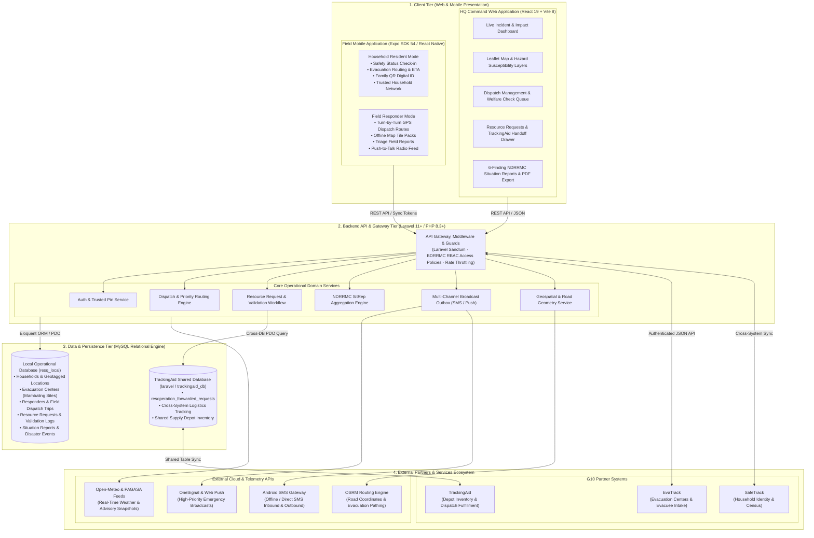

# RESQPERATION — System Architecture

**Project Title:** RESQPERATION: Barangay Disaster Risk Reduction and Management Coordination System  
**Target Operational Area:** Barangay Mambaling, Cebu City  
**Document Version:** 1.0.0  
**Last Updated:** October 28, 2026  

---

## 1. High-Level System Architecture Diagram

---

## 2. Architecture Layers & Component Specifications

### 2.1 Presentation & Client Tier
| Subsystem | Core Technologies | Scope & Key Functions |
| :--- | :--- | :--- |
| **HQ Command Web Application** | • React 19 • Vite 8 • React Router • Leaflet / React-Leaflet • Vanilla CSS Design System | • **Live Operational Dashboard:** Real-time incident counts, household safety counters, and weather snapshots. • **Geospatial Mapping:** Interactive map of Barangay Mambaling sitios, hazard layers (flood/liquefaction), and active evacuation centers. • **Dispatch Operations:** Turn-by-turn responder routing, welfare check prioritization, and field trip monitoring. • **Logistics & Resource Requests:** Multi-channel intake, validation, stock verification, and TrackingAid handoff tracking. • **Situation Reporting:** 6-Finding NDRRMC Situation Reports with automated PDF, CSV, and Excel exports. |
| **Field Mobile Application** | • Expo SDK 54 • React Native • SQLite Local Storage • Expo Location & NetInfo | • **Resident Mode:** Personal/family safety status reporting, evacuation center routing with distance and ETA calculation, digital household QR identification, and trusted household network. • **Responder Mode:** Live GPS telemetry dispatch, road navigation, field report logging, offline map tile cache, and push-to-talk radio communications. |

### 2.2 Application Gateway & Domain Services Tier
| Module | Technology | Functional Architecture |
| :--- | :--- | :--- |
| **API Gateway & Security** | • Laravel 11+ / PHP 8.3+ • Laravel Sanctum • Custom Middleware Pipeline | • Bearer token authentication for web sessions and mobile devices. • Strict BDRRMC role-based access control (`operations_admin`, `chair`, `preparedness`, `response`, `recovery`, `rescuer`, `household_resident`). • External intake authorization (`X-RESQPERATION-INTEGRATION-KEY`). • Rate limiting and atomic mutation middleware. |
| **Core Domain Services** | • PHP 8.3 Typed Domain Workflows • Eloquent ORM | • **RescueDispatchWorkflow:** Automated prioritization ranking for vulnerable households (infants, elderly, PWDs). • **ResourceRequestService:** Request lifecycle management, stock limit guards, and TrackingAid shared DB handoff. • **SituationReportSync:** Multi-source data synthesis across population, casualties, and infrastructure damages. • **Broadcast Engine:** Multi-channel dispatch via Web Push, OneSignal mobile push, and cellular SMS gateway. |

### 2.3 Data Persistence Tier
| Database Store | Engine | Structure & Contents |
| :--- | :--- | :--- |
| **Local Operational Database (`resq_local`)** | MySQL 8.0 / InnoDB | • Complete operational dataset for Barangay Mambaling. • Tables: `households`, `household_members`, `responders`, `dispatch_trips`, `evacuation_centers`, `resource_requests`, `request_validations`, `disaster_events`, `situation_reports`, `hazard_layers`. |
| **Shared Bridge Database (`trackingaid_db` / `laravel`)** | MySQL 8.0 (Cross-Host LAN) | • Dedicated cross-system integration table: `resqperation_forwarded_requests`. • Links validated ResQperation relief requests to TrackingAid depot fulfillment records without code coupling. |

### 2.4 External Integration Interfaces
| External Entity | Integration Pattern | Protocol / Payload |
| :--- | :--- | :--- |
| **EvaTrack** | Authenticated REST API | HTTP `POST /api/v1/external/resource-requests` with JSON payload for camp relief intake. |
| **SafeTrack** | Data Synchronization | Shared census and household identity baselines. |
| **TrackingAid** | Relational Bridge Table | Cross-database queries on `resqperation_forwarded_requests` using unique tracking references (`TA-YYYYMMDD-XXX`). |
| **Open-Meteo & DOST-PAGASA** | REST API & Feeds | Weather forecasts, storm warnings, and seismological advisory snapshots. |
| **OSRM** | Public Routing Engine | On-demand road network geometry and routing coordinates for evacuation pathing. |
| **OneSignal & Android SMS Gateway** | Push Notification & Cellular Webhook | Automated priority alerts to mobile devices and SMS fallback for offline residents. |
